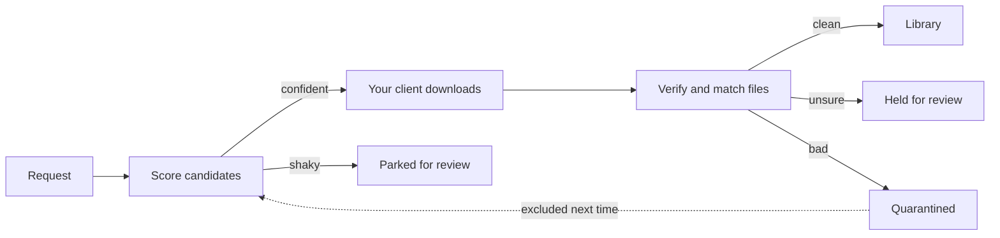

> [!WARNING]
> **This is an AI vibe-coded fork** of [DroppedNeedle](https://github.com/DroppedNeedle/DroppedNeedle). It was built with AI coding tools rather than written by hand, and it is not affiliated with or supported by the upstream project. Report problems with this fork here, not upstream. Every change is in the [commit history](https://github.com/cookie-monster1649/DroppedNeedle/commits/nuc/v3.0.0-beta.5/).

## About this fork

This fork is based on upstream `v3.0.0-beta.5` and lives on the branch `nuc/v3.0.0-beta.5` (the beta.4-based branch `nuc/v3.0.0-beta.4` is kept as it was). It runs on a single home-server deployment. Its main aim: music MusicBrainz doesn't know (Deezer and Spotify releases) should be handled as well as music it does.

### Dropped in favour of upstream beta.5
- **A playlist row's play button starts the queue at that row:** upstream fixes the same bug ("Play on a playlist row starts the track you clicked").
- **Copies list only albums with files:** upstream's shared "owned album" rule (live and with an indexed track) now covers this, and the fork's lists use that rule instead of its own.
- **Rescan after a Deezer tag write:** upstream now asks for a scan of every written folder when any Library management run (or undo) ends, so the fork's own rescan is gone.
- **Deezer search** now sits beside upstream's new exact-title ranking: a Deezer album whose title is the query ranks as exact, after MusicBrainz's exact albums.

### What it changes

**Deezer metadata and other sources**
- **Deezer as a metadata source (stage a):** Deezer albums and artists get permanent stand-in IDs prefixed `d0ab1e00-50c3-8…`, recorded in a `source_identities` table. Their pages are served from Deezer data, and a single guard keeps these IDs away from MusicBrainz, Cover Art Archive, ListenBrainz, Last.fm and AudioDB.
- **Deezer albums request as one download (stage b):** an album on stand-in IDs is requested through the normal edition request. One task with the Deezer track list as its plan asks only for the missing tracks. Tracks a settled partial or failed task left behind are asked for one by one, at their place on the album, after 30 minutes.
- **Deezer artist pages and covers (stage c):** artists on stand-in IDs show the library's albums by them and their Deezer picture, and their Last.fm bio is looked up by name. Albums on stand-in IDs with no art of their own use the Deezer cover.
- **Deezer discography:** an artist on stand-in IDs lists every album, EP and single Deezer has for them (up to 300), not only the ones you hold. Each links to a normal album page with its Deezer tracklist, and Request album plans one download from it.
- **Deezer search:** Deezer's artists and albums MusicBrainz lacks show beside MusicBrainz's in search (Settings → Advanced switch).
- **Deezer editions (stage d):** Deezer's other editions of an album (explicit or clean, deluxe, remastered) are looked up monthly and listed as editions of it, so any of them can be requested.
- **Deezer tags:** files from Deezer albums get `DEEZER_ALBUMID`, `DEEZER_TRACKID` and `DEEZER_ARTISTID` tags.
- **Switching to MusicBrainz:** an album moves to MusicBrainz automatically once MusicBrainz has a confident match.
- **Deezer album pages:** these show the full tracklist, with missing tracks in line, just like a MusicBrainz album.
- **Writing names to files:** accepting a Deezer match writes its titles and artists into the files.
- **Matched, not local-only:** albums with an accepted Deezer match count as matched rather than local-only.
- **Deezer albums linked to MusicBrainz:** when a Deezer album (stand-in ID) turns out to be one MusicBrainz knows, the stand-in is linked to the MusicBrainz album (`source_links` table). This happens when files fetched or held for it go in under a MusicBrainz album of the same title, when a person matches its held files to one, or when a request finds it first. The stand-in's page then opens the MusicBrainz album, and its request and wanted watch settle once the library holds that album. A background pass (two minutes after start, then hourly) repairs albums handled before links existed, checks up to 25 still-open unlinked stand-ins per pass at MusicBrainz (barcode, then a confident artist, title and track-count match; paced, and a miss is not asked again for a week), and settles what is still asked of every linked stand-in. When the library holds the MusicBrainz album, queued and retrying downloads stop as "already in the library", the request and wanted watch settle, and held files are decided as already owned (their copies stay in the held folder; nothing is deleted). When it does not, queued downloads and the wanted watch move to the MusicBrainz album, and held entries are pointed at it and re-checked by the held list's own clear-match pass. A failed download for a linked stand-in is never retried as the stand-in: the retry stops when the album is in the library, else asks for the MusicBrainz album.
- **Playlist-folder import:** an admin-run, one-off import of a folder whose subfolders are playlists of audio files (set `PLAYLIST_IMPORT_PATH` to it in the container; `PLAYLIST_IMPORT_REPORTS` sets where reports and progress go, by default `playlist-import/` beside the library database). NAS housekeeping (`@eaDir`, `.DS_Store`, `*@Syno*`) is skipped. Each song is resolved the way Spotify playlist sync resolves tracks: ISRC at MusicBrainz, then ISRC at Deezer (a Deezer album MusicBrainz knows is linked to it), then barcode at MusicBrainz, then a name match at MusicBrainz and then Deezer. The same song in several playlists is imported once (the highest-bitrate copy), and songs the library already holds are left out. `POST /api/v3/admin/playlist-import/dry-run` reads tags, resolves and writes `dry-run-report.json` and `dry-run-report.txt` (counts per playlist, plus every unresolved song); nothing in the library changes. `POST /api/v3/admin/playlist-import/run` then imports the resolved songs album by album through the normal placing path, as if a person had chosen the album: files are copied, the source is never changed, any quality is taken, and global settings are not touched. Progress is saved as it goes, so a run that stops (a lookup or MusicBrainz outage) carries on where it stopped when started again, and files already handled are never imported twice. Unresolved songs and albums that do not match are listed in `import-report.*`, not added to To Decide; only a file the placing step itself holds (as for any import) goes there, and the report lists it too. `GET /api/v3/admin/playlist-import/status` shows the step, progress and last result. `POST /api/v3/admin/playlist-import/stop` stops a running import gently after the file it is on, keeping its progress.
- **Playlist-folder import, public playlist match:** when the folders are exports of Spotify playlists that are still public, set `PLAYLIST_IMPORT_SPOTIFY_USER` to the owner's Spotify user id (or `PLAYLIST_IMPORT_SPOTIFY_PLAYLISTS` to a comma-separated list of playlist links). After the normal resolver, both the dry run and the real run list those playlists through an admin's linked Spotify account (with the same pacing, rate-limit waits and call counting as playlist sync; a wait Spotify asks for is waited out), map them to folders by name (case and punctuation ignored, otherwise exact), and match each song still unresolved to an entry of its folder's playlist by title (version notes such as "(Original Mix)" and featured credits ignored), primary artist and length within 3 seconds, falling back to a match across all the playlists when that is unambiguous. The entry's ISRC then resolves it (MusicBrainz, then Deezer), else its Spotify album does. The playlists and their entries are kept with the import's progress, so a rerun within a day makes no Spotify calls and a playlist whose snapshot did not change is never read again. If Spotify refuses to read another user's playlists (development-mode apps may be limited to playlists of the signed-in user), the step stops with a note in the report and the run carries on. Reports gain per-folder counts: matched through the playlist, still unresolved, and folders or playlists left unmapped.
- **Playlist-folder import, playlist CSV match:** instead of reading playlists from Spotify, export them as CSV files (for example with Exportify, one `.csv` per playlist) into a folder visible in the container and set `PLAYLIST_IMPORT_PLAYLIST_CSVS` to it; when it is unset, top-level `.csv` files in `PLAYLIST_IMPORT_PATH` itself are used (the audio walk only reads subfolders, so they are never imported). When there are CSVs, it takes the place of the Spotify API: each file is one playlist named by its file name (mapped to a folder by name the same way, so `Late_Night.csv` maps to `Late Night`), columns are read by header name (`Track Name`, `Artist Name(s)`, `Album Name`, `Duration (ms)`, `ISRC`, `Track URI`; quoted fields, commas and a byte-order mark are fine), and the rows are matched and resolved exactly like Spotify's entries. Songs resolved this way are recorded as `playlist_csv` and get their own report column (`pl-csv`) and per-folder section, with a note for any file that does not read. Reruns only look at songs still unresolved; no Spotify calls are made.
- **Playlist-folder import, retrying unpaired albums:** a song whose album did not pair (`unmatched:*` in the report) is tried again by the next run. When the first try leaves files unpaired, they are tried once more on the edition that carries the recording the resolver found (read from the recording itself, or from the release group's own page when the group's edition listing comes back empty), with that recording set on files that name none. Files of an album the library already keeps on another edition still follow that edition and stay listed.
- **Playlist-folder import, import by tags:** after every resolver, the playlist match and the edition retries, each file still left (readable, not a duplicate, not already in the library) is copied into the library folder as `<album artist, else artist>/<album>/<file name>` (staged in a hidden management folder and renamed into place; the source is never changed). The library then treats it like any file it finds with no MusicBrainz identity: the scan groups it by its album artist and album tags, identification tries it, and an album nothing fits keeps its own tags under the library's usual unmatched flag, ready to be matched by hand later. Nothing is sent to To Decide. These files are recorded as `tags_only` (with their library path), counted per playlist in the report's `tags` column, and never copied twice; if a later run resolves one properly, the tag-only copy is left as it is and the report lists it. Synced playlists link to these tracks by title and artist like any other library track, and their songs count as already held, so they are not downloaded again. On by default; set `PLAYLIST_IMPORT_TAGS_FALLBACK=false` to turn it off.
- **Playlist-folder import, provider links:** last, every file the import put in the library (by any resolver, the playlist CSV match or by tags) and every file it found already there gets provider links on its library track, so a later Spotify playlist sync links each entry straight to the file by Spotify id or ISRC. Files pair to the playlist CSV rows by ISRC first, then by the CSV match the import recorded, then by a row of the folder's own CSV with the same title (version notes ignored), first artist and length within 3 seconds, and last by the title cut at its first dash or bracket (tags that leave off "- Someone Remix"). A row never goes to two different songs; copies of one song share it, and a duplicate links its kept copy. Each track gets a `spotify` track link for every Spotify id its rows carry and an `isrc` recording link for their ISRCs, else the file's own tag ISRC (so folders with no CSV still link by ISRC). Links are automatic, written once, and never replace one the track has. `import-report.*` gains a section with the files linked by Spotify id, by ISRC only, and with no link (each with its reason), plus the CSV rows nothing paired to. The step also runs on its own a few minutes after start and every 30 minutes when the import's state changed or tag-only copies still wait for the scan, so files imported before the step existed get their links without a re-import; `POST /api/v3/admin/playlist-import/link-ids` runs it now.
- **Playlist-import download hold:** while a playlist-folder import is pending or running, a synced Spotify playlist that is one of the import's playlists does not request its new songs; they are kept and requested once the real run finishes, or when an admin calls `POST /api/v3/admin/playlist-import/release-hold`. The import status shows the hold's state and how many songs it holds.
- **MusicBrainz checked before a Deezer album is requested:** an album request, a discography or batch request, or a Spotify saved album on a stand-in ID first looks for the album at MusicBrainz: Deezer's UPC as a barcode, then a confident artist, title and track-count match. When found, the MusicBrainz album is requested and the stand-in linked. A lookup failure, or a batch past its 30-second check budget, requests the stand-in as before.

**Check albums, matching and editions**
- **Best guess:** albums MusicBrainz lacks get Deezer suggestions, and strong guesses from any catalogue appear under Best guess.
- **New tabs:** an Artists tab lists artists MusicBrainz lacks, and a Duplicates tab lists albums held twice.
- **Closest candidate:** an album with no good match shows its nearest candidate, so you can use that.
- **Default edition:** requests default to the edition with the track count most editions share, not a bonus edition.
- **Matching by hand:** a hand match keeps the edition that was requested. Partial albums match by exact name or ISRC.
- **Fewer albums stuck in To Decide:** when the same tracks arrive more than once, only the best copy of each is kept. Weak held albums then re-match by themselves.
- **Merging:** "Merge albums" folds copies of a release together, keeping the best file of each song. Same-folder albums merge by themselves.
- **Same-release albums merge by themselves:** local albums matched to the same MusicBrainz release on one library root are folded into the oldest one by a background pass (its first run after start is the backfill), through the same merge as the album page. Albums a person grouped by hand are left alone, and copies that hold the same track stay apart, so the "Copies in your library" picker only shows for real clashes.
- **Ghost copies and clashes on one release:** a copy whose folder is gone from disk (every track missing, files confirmed absent) is folded into the live album of its release by the same pass, so its old missing rows no longer bring up the picker. When two live copies both hold a file for the same release track, the better file (format, then bit depth, sample rate and bitrate) stays, the other goes to the recycle bin (Put back can return it), and the albums merge. Albums a person grouped by hand are still left alone.

**To Decide (held files)**
- **Other artists' songs left out:** a file tagged with another artist whose title matches no track of the album is never held under that album or given a track number. A download that is mostly such files (a mixed compilation) is rejected as the wrong album, blocklisted, and the next source is tried.
- **No borrowed track numbers:** a held file shows a track number only when it is paired to that track, or its own title is the title at that position.
- **Grouped albums:** albums held for the same artist or from the same download sit in one collapsible group with its artist and count. The group has Import all / Discard all for each reason its albums share, and each album and file keeps its own buttons.
- **Matching to a Deezer album:** Match to an album pairs held files against a Deezer-only album's own track list (its stand-in releases), and places them under that album. The picker searches Deezer too (with Deezer search switched on): MusicBrainz's albums first, then the Deezer albums it lacks, marked "Deezer". A match that could not place anything says why (files gone from disk, no track list to pair against) instead of answering "Nothing changed", and the picker stays open.
- **Plain reasons:** every hold reason is explained from the file itself. For example, the artist and title the file claims against the album you asked for, or its real format, bit depth, sample rate or bitrate against your quality settings, plus the setting to change ("Add 24-bit / 192 kHz FLAC in Settings → Download Client → Acquisition quality…"). Each album shows each reason once, with a count.

**Discovery**
- **ListenBrainz greyed out instead of a notice:** upstream falls back from ListenBrainz to Last.fm on the server and explains it in a notice. The fork drops that notice: while ListenBrainz is unavailable, its tab in the ListenBrainz / Last.fm switcher (artist pages, Your top, Trending, Popular) is greyed out, and the switcher moves to Last.fm by itself. The tab comes back when ListenBrainz answers again (or after five minutes), without moving anyone off the tab they are on. Other notices (needs your account, has nothing here, both unavailable) stay as upstream has them.

**Spotify and playlists**
- **Spotify metadata:** songs import with Spotify's title, artist, album, ISRC and link, even when MusicBrainz doesn't know them.
- **Syncing:** imported playlists can follow Spotify, and new songs added there are requested automatically. The playlist sync (Liked Songs, followed artists and saved albums ride on it) runs every 2 hours (`SYNC_INTERVAL`), down from 15 minutes, to spare Spotify's quota. **Sync all now** on Import from Spotify checks your synced playlists and Liked Songs straight away, in the background. Each playlist is still imported only when its `snapshot_id` changed. It runs at most once in five minutes, is refused while Spotify's wait runs (the toast says how long), and the button rests for a minute after a click.
- **Liked Songs:** Liked Songs sits first on Import from Spotify as an ordinary playlist ("Liked Songs", in Spotify's order). Its card has Download all, a sync toggle and Sync Liked Songs. It syncs like any playlist: new likes are added (and requested while sync is on), unlikes leave the playlist, and nothing is deleted from the library.
- **Your Spotify library (Profile → Spotify):** "Followed artists" follows the artists you follow on Spotify here, with auto-download off; nothing is downloaded. Unfollowing on Spotify unfollows here only when the sync made that follow; a follow made by hand is never removed. "Saved albums" opens a review: every match starts selected and can be deselected, unmatched albums show as not found, and confirming requests the rest as album requests. Albums saved later show as new and are never requested until you confirm them. Held matches are favourited, and un-saving removes only that favourite. Both have a sync toggle (every 2 hours, with the playlist sync) and run on demand. Matching is never a guess: MusicBrainz first (barcode, Spotify link, then a confident title, artist and track-count match; for artists, a Spotify link or a name backed by shared albums), then the Deezer stand-in. Connections made before this need one **Reconnect**, for the `user-library-read` and `user-follow-read` scopes; imported playlists stay linked.
- **Keeping to Spotify's rate limits:** an app in Spotify's development mode is limited hard, and its artist-albums read most of all (about 100 of them in 90 seconds drew a one-hour wait). So a followed artist is matched by its MusicBrainz Spotify link, then the artist credited on a saved album already matched by barcode or link, then its name (MusicBrainz backed by the saved albums' titles, then Deezer); its albums are read at Spotify only for what is still unmatched, at most 10 artists a pass, and at most once a month per artist. Each lookup is recorded before it calls Spotify, and an artist that stays unmatched waits a day, a week, then a month before the next try. A wait Spotify asks for ends the pass, nothing calls Spotify again until it is over, and it is kept in the database (`acquire_spotify_cooldowns`) so a restart honours it. The card says "Sync paused. Spotify rate limit: asked to wait until HH:MM UTC" instead of "could not be reached", which now means only that no answer came ("Spotify answered with an error" otherwise). The sync no longer runs on start (the first pass waits one interval), Spotify is paced at 1 request a second (burst 3), followed artists are read once a day (sooner while a pass cut short left artists unlooked-up), saved albums are read only down to the first page already known with a full read once a day, and "Sync now" runs a part at most once in five minutes (the button rests for a minute after a click).
- **Spending as few Spotify calls as possible:** the development-mode quota is shared per developer account, by endpoint, and its refusal (`QUOTA_EXCEEDED`) can ask for hours. The playlist sync used to read each synced playlist's metadata (`/playlists/{id}`) every 15 minutes (then the interval) just for its version, and again with its items on every import: about 96 calls a day per synced playlist. Now each pass reads the owner's playlist list once (`/me/playlists`, 50 a page), whose `snapshot_id` is each playlist's version, and a playlist is read only when its snapshot changed or it is new, and then only its items (`/items`, 100 a page, with a `fields=` filter). An unchanged pass makes no per-playlist call. The list (names, covers, counts, snapshots) is kept in the database (`acquire_spotify_listed_playlists`); the Import from Spotify page and the library card are served from it and never call Spotify on a page view; **Refresh from Spotify** reads the list again. Liked Songs is read newest first, stopping at the first page of songs already known, with a full read at most once a day. The playlist import no longer asks for one album at a time: barcodes come from the saved-album pages. Each refusal (429) is classified as quota or rate limit, logged as a WARN line with the endpoint and Retry-After, kept with the persisted wait, and shown as "Spotify quota used up" or "Spotify rate limit". When the first call after a wait is refused again, the next wait is the larger of Retry-After and twice the last, up to 24 hours; a success resets it, and nothing calls Spotify just to probe. Calls are counted per endpoint in memory and summarised in the log hourly and on each refusal.
- **Pasting Spotify links into search:** an `open.spotify.com` track, album or artist link (with `/intl-xx/` or `?si=`) or a `spotify:` URI opens the album (the song marked on it) or the artist page. It is resolved through `GET /api/v3/resolve/spotify?url=`: by ISRC (MusicBrainz, then Deezer), barcode or Spotify link, then a confident name match. Nothing confident reads "Couldn't find … on MusicBrainz or Deezer" with Spotify's name. With no Spotify connection only the name is known (oEmbed), so a song is never matched by name alone.
- **Import screen:** a loading state while the tracklist is fetched, then accurate per-track statuses.
- **Linking to your library:** playlist entries link to the library's copy by ID, by request, or by name. Name-linking ignores apostrophe style (’ vs ').
- **Removed songs:** a song removed from a playlist is remembered for that file only. It isn't fetched again, but can be requested anew.
- **Per-row status:** each row shows in library, missing, fetching, waiting for a decision or failed, with its own request button.
- **Live playlist folders:** every user's playlists (Spotify-synced ones included) are kept on disk as `<root>/<user display name>/<playlist>/<NN - Artist - Title.ext>`, NN being the playlist order. Each file is a **hardlink** to the library file, never a copy. A file share such as Nextcloud can then show them for free. The root is the admin setting `/api/v3/settings/library/playlist-folders` (`{"path": …}`). While that is empty, the `PLAYLIST_FOLDERS_PATH` environment variable is used; both empty means off. The root must sit beside the library on the **same mount inside the container**, for example `/data/media/music_playlists` under a single `/data` bind. Two separate binds make `link()` fail with EXDEV. It may not be inside or over a library root, the staging folder or the import folder. At start a probe link is made. If the filesystem refuses (EXDEV, EPERM, ENOTSUP), the job turns off and says so in the log; it never copies. A loop checks a per-user fingerprint every 30 s. A change (create, edit, reorder, rename, delete, Spotify sync, an import linking a wanted track, an upgrade replacing a file) lands after one quiet tick, and everyone is fully reconciled every 10 minutes. A reconcile adds missing links and removes stale ones and empty folders. It follows playlist renames by id (marker files in each folder), relinks when the inode no longer matches the library file, skips entries with no local file, and writes via a temporary name and rename. It also sanitises names (`/ \ : * ? " < > |`, trimmed, capped, clashes numbered). A second pass with nothing changed changes nothing. After a user's folder changes, the job writes `<root>/.rescan/<folder>` for a host-side helper to ask the file share to rescan, so the server never needs the docker socket. Names are NFC-composed, since Nextcloud refuses decomposed names. The root also gets `.users.json`, listing every user with a folder: id, username, folder, email, SSO (OIDC) subjects, and an optional explicit Nextcloud user from the setting's `nextcloud_users` map (keyed by username). It is rewritten only when it changes. A host helper uses it to give each user their own file-share mount automatically: override first, then exactly one account with the same email, then the same OIDC subject, never the display name.

**Requests and downloads**
- **Requests by name:** you can request a track by name, with no MusicBrainz ID. A download that agrees with the request imports by itself.
- **Already in the library:** a request for a song the library already holds is marked done, not searched. Held imports never file a second copy of a song.
- **Track numbers:** song requests carry a track and disc number (from Spotify or Deezer), used when a file has none.
- **Deezer album requests:** "Request album?" on a Deezer album asks for every missing track.
- **Plugin sources:** YouTube and SoundCloud plugin searches get the album and the track length. Length is checked against Deezer, and a hold with no release doesn't blocklist the source.
- **Usenet:** a finished job is found even when the mount points at a category folder.
- **Manual import on a still-hunting song:** curators get an "Import a file" button on each still-hunting song in Downloads, with a small menu. "Upload file" takes one audio file and imports it at that song's place (its release track, or its want's ask and identities), with no matching step, through the normal tagging, naming and duplicate handling; the hunt then ends. "From YouTube / SoundCloud" takes a pasted youtube.com, youtu.be, music.youtube.com or soundcloud.com link, or a YouTube link the app already knows for the song, and fetches the best audio with yt-dlp (pinned in the image and checked by checksum; run with no shell, a 10-minute limit and a 200 MB cap). The codec is kept as it comes (Opus, AAC or MP3, never transcoded to a fake lossless), so the file lands at the low quality tier and a later upgrade can replace it. Progress and errors show in the dialog; a file the library won't take waits in To Decide.
- **Bulk playlist requests:** an admin can ask for every song a playlist holds that the library does not play, hands-off. `POST /api/v3/admin/bulk-requests` with `{"playlist_id": …, "dry_run": true}` only estimates (songs missing, album downloads, songs asked alone by recording or by name); without `dry_run` it starts a run at `per_hour` songs an hour (default 60), optionally stopping after a `pilot` of N songs until resumed. Two or more songs of one album go as one album download for just their tracks, on an edition MusicBrainz shows holding them; the rest are asked for one by one, like playlist sync asks. Downloads a run sends skip the search review. Songs whose album download found no usable copy are asked for again on their own, where plugins can serve them. `GET /api/v3/admin/bulk-requests/{id}` lists each song as queued, in progress, done, review or failed, with the reason and counts per reason; `POST …/{id}/state` pauses, resumes or cancels it.
- **Fewer reviews for playlist songs:** a playlist song found only as its album's track imports as the song when the file's recording tag is the requested recording or it plays within 3 seconds of it (title and artist must already agree). Album downloads on a Deezer stand-in that were held for want of a release are checked against the Deezer tracklist by the held list and imported on a clear match.
- **Retries that repeat stop repeating:** when an ask's last two downloads ended for the same reason about the copies (no source, a hold) and the download settings have not changed, the next retry waits a week instead of adding another failed row. Changing download policy, source priority or plugin settings lets it go at once.
- **Renamed Soulseek copies found:** slskd saves a repeat download beside a same-named file as `name_<digits>.ext`; the locator now finds that copy (newest of the expected size) instead of giving up as "files missing".
- **Downloads page:** a found copy can be used as the other edition it holds. Several Soulseek searches run at once. A 30-second sample button sits on downloads and held files.

**Artists**
- **Linking to MusicBrainz:** an artist with no MusicBrainz ID is linked through its Deezer artist's MusicBrainz URL relation.
- **Shared IDs:** if another artist already holds that MusicBrainz ID, a merge is suggested in the Artists tab.
- **Settling unlinked artists:** an artist with no MusicBrainz ID is linked when its matched albums' release credits name one MusicBrainz artist under its name, or when its name belongs to only one MusicBrainz artist and that artist links to the same Deezer artist. A name several MusicBrainz artists share is never settled automatically, and a person's link or "Not it" is never overridden.
- **Splitting joined credits:** tags that join several artists in one string ("A/B", "A; B") are split into the individual artists when files are indexed, and a one-time background job re-credits rows already in the library, retiring the joined artist into the first. Commas, "&", "x", "vs" and "feat." split only when every part is an artist the library already knows, so duos and band names such as "Earth, Wind & Fire" stay whole.
- **Evidence ladder for artists:** an artist still unlinked is checked against its tracks' ISRCs (MusicBrainz recording credits), the Deezer artists its tracks link to (MusicBrainz URL relations), and, for names several MusicBrainz artists share, collaborators and labels it shares here. It is linked only when exactly one MusicBrainz artist fits and nothing disagrees; names are compared across case, accents, a leading "The", "&"/"and" and punctuation. When MusicBrainz has no such artist but one Deezer artist of the name lists its albums, it links to that Deezer artist so it gets a normal artist page, and moves to MusicBrainz once MusicBrainz knows it. Answers are cached, Spotify is never asked, and each open row in the Artists tab says why it is still open.
- **Bulk accept:** admins can accept every exact-name best guess in the Artists tab at once, after seeing the count. Names shared by several MusicBrainz artists are skipped. The list shows artists with the most albums and tracks first.

**Other**
- **Login:** `OIDC_NEW_USER_ROLE` sets the role for new SSO accounts.
- **Player:** a track that ends unheard is reloaded transcoded.

### Keeping upstream merges easy
- Changed upstream code is marked with `Fork:` comments, kept small, and placed at hook points.
- New behaviour lives in additive tables (fork extension migrations) and isolated modules, for example the source layer.
- Stand-in IDs reuse the existing MusicBrainz ID columns, so upstream's routes, caches and plans work unchanged.
- To merge upstream:
  1. `git fetch upstream --tags`, then rebase the fork's commits onto the new tag on a new `nuc/<tag>` branch
  2. Resolve the `Fork:` hunks.
  3. Run the Rust and frontend suites. Source gates (`tests/server/source_gates.rs`) list fork spawn sites.

### Build and deploy
- **Normal path:** pushing the branch runs CI, and the `nuc-image` workflow publishes the image. The deployment then runs `docker compose pull && docker compose up -d`.
- **Fallback when GitHub Actions is unavailable** (for example, budget-blocked):
  1. Run the test suites locally.
  2. `docker build` the image on the host under the same tag, keeping a rollback tag of the previous image.
  3. Run `up -d` without pulling.
  4. Prune the build cache.
- **Before any deploy:** back up `library.db`, and `metadata-cache.db` when sources change, and restart only when no import is running.

### Known gaps
- **The metadata-source roadmap is incomplete:** stage e (Spotify as a source) is still to do. Identify does not offer Deezer releases as candidates for albums with no confirmed match; those still go through the Deezer suggestion and confirmation flow.

The fork's plan and notes are in [docs/fork/PLAN.md](docs/fork/PLAN.md).

<div align="center">


**Request music. Own everything.**

DroppedNeedle is a self-hosted music request and discovery app for you and the people you share a server with. Search MusicBrainz, request an album or a single track, and it fetches it through your own slskd, SABnzbd or NZBGet, checks every file and files it in your library. Then play it in the browser, or in Symfonium, Finamp, Feishin and other Subsonic or Jellyfin apps.

One container. No Lidarr.

[](https://github.com/DroppedNeedle/DroppedNeedle/actions/workflows/v3-ci.yml)
[](LICENSE)
[](https://github.com/DroppedNeedle/DroppedNeedle)
[](https://hub.docker.com/r/droppedneedle/droppedneedle)
[](https://discord.gg/B5suDg7gu2)
[](docs/README.md)

[Docs](docs/README.md) | [Website](https://www.droppedneedle.com/) | [Discord](https://discord.gg/B5suDg7gu2) | [Issues](https://github.com/DroppedNeedle/DroppedNeedle/issues) | [Sponsor](https://github.com/sponsors/HabiRabbu)

</div>

---


<details>
<summary>More screenshots</summary>


</details>

> [!NOTE]
> DroppedNeedle only drives a download client you run yourself. It never joins a P2P network, ships no indexers and hosts no audio. What you fetch, and what your client shares, is your call and your responsibility.

## What it does

- **Requests** for whole albums or single tracks from the MusicBrainz catalog, with an approval queue for the User role.
- **Downloads** through your slskd, your SABnzbd or NZBGet with Newznab indexers or Prowlarr, or a plugin. It scores the candidates, verifies every file and holds what it isn't sure of.
- **Wanted and upgrades**: failed and partial requests are searched again until a verified copy shows up, and a better copy replaces a worse one.
- **Your library**, scanned and identified against MusicBrainz and AcoustID without renaming or retagging anything. Browse, search, rate and play it.
- **Library Management**, off until you turn it on: Picard-style tags, artwork and file naming behind a preview, with undo.
- **Drop imports** for music you bought elsewhere: drag in a zip or loose files.
- **Discovery**: trending, charts, genres, recommendations from ListenBrainz or Last.fm, a discover queue, a weekly mix, new releases from artists you follow, and gig alerts for your cities.
- **A web player** with a queue, a 10-band EQ, lyrics and live now-playing.
- **Playlists** mixing your library, Jellyfin, Navidrome, Plex, YouTube and Spotify imports.
- **Plugins** for more download sources, scrobble targets and purchase links.

Every feature, one line each: [docs/features.md](docs/features.md).

How a request moves:



The engine searches your client, ranks candidates, and accepts a confident match by itself. Close calls wait for review instead of guessing.

## Quick start

You need Docker, a music library, and a download client. The example below uses slskd; [SABnzbd](https://sabnzbd.org/) or [NZBGet](https://nzbget.com/) with Newznab indexers or Prowlarr works too. DroppedNeedle runs neither for you: see [Download clients](docs/download-clients.md).

**1. Save this compose file.** Images are on [Docker Hub](https://hub.docker.com/r/droppedneedle/droppedneedle) as `droppedneedle/droppedneedle`.

```yaml
services:
  droppedneedle:
    image: droppedneedle/droppedneedle:latest
    container_name: droppedneedle
    environment:
      - PUID=1000            # run `id` on your host to find your user/group ID
      - PGID=1000
      - UMASK=027            # secure default; 002 for trusted group-writable media
      - PORT=8688
      - TZ=Etc/UTC           # e.g. Europe/London, America/New_York
      - SLSKD_DOWNLOADS_PATH=/data/slskd/complete
    ports:
      - "8688:8688"
    volumes:
      - ./config:/app/config
      - ./cache:/app/cache
      - ./plugins:/app/plugins  # omit and installed plugins vanish on recreate
      - ./imports:/app/imports  # uploads waiting for a match; omit and they vanish on recreate
      # One shared parent mount keeps the library and completed downloads on one
      # boundary so imports move fast. Do not nest extra binds under /data.
      - /path/to/media:/data:rw
    restart: unless-stopped
```

The full annotated compose, with an optional slskd sidecar, is [docker-compose.example.yml](docker-compose.example.yml). Every environment variable is in [Configuration](docs/configuration.md).

**2. Start it.**

```bash
docker compose up -d
```

Then open [http://localhost:8688](http://localhost:8688).

**3. First run.**

1. Create the first admin account. This happens once.
2. Add your library path under Settings > Library, using the in-container path (e.g. `/data/music`).
3. Add your download client under Settings > Download Client, then Test and Save.
4. Press Scan for changes on Settings > Library. The scan reads and identifies files without renaming or retagging anything.
5. Search the catalog, open an album, and Request it. Watch it land live on the Downloads page.

Bringing in a collection you want filed and tagged? See [Bringing in an existing library](docs/downloads.md#bringing-in-an-existing-library).

To update, run `docker compose pull` and `docker compose up -d`. DroppedNeedle backs up its database before a new version changes it: see [Backups and restore](docs/backups-and-restore.md).

## Coming from v2

Stop v2, switch the image to `:latest` (or a version such as `:v3.0.0`) and start it. It serves an upgrade page that checks first, upgrades your data in place and keeps your v2 files so you can go back.
Callback addresses for single sign-on, Spotify playlist import and MusicBrainz contributions change, and v2 plugins need porting.
Follow [Upgrading from v2](docs/upgrading-from-v2.md), and read [What changed in v3](docs/v3-changes.md) first.

## Works with your apps

- **Music apps.** DroppedNeedle answers the OpenSubsonic and Jellyfin APIs, so Subsonic apps (Symfonium, Feishin, Arpeggi) and Jellyfin apps (Finamp, Jellify, Manet) can play your library. [Connect your music app](docs/connect-your-app.md) says what to enter.
- **Media servers.** It plays from Jellyfin, Navidrome, Plex or local files, and reports plays back to your own account there.
- **Scrobbling.** ListenBrainz and Last.fm, per user.
- **Sign-in.** Single sign-on through any OpenID Connect provider, and sign-in with Plex or Jellyfin: see [Accounts and sign-in](docs/accounts-and-sign-in.md).

## Docs

- [Configuration](docs/configuration.md): environment variables, folders, permissions, where each setting lives, updating.
- [Download clients](docs/download-clients.md): slskd, SABnzbd, NZBGet and drop imports.
- [Accounts and sign-in](docs/accounts-and-sign-in.md): roles, single sign-on, Plex and Jellyfin sign-in, recovery.
- [Connect your music app](docs/connect-your-app.md): Subsonic and Jellyfin apps.
- [Your library](docs/library.md) and [Library Management](docs/library-management.md).
- [Requests and downloads](docs/downloads.md) and [Discovery](docs/discovery.md).
- [Reverse proxy and security](docs/reverse-proxy-and-security.md) and [Backups and restore](docs/backups-and-restore.md).
- [Troubleshooting](docs/troubleshooting.md).
- [Plugins](PLUGINS.md) and [Writing a plugin](docs/writing-a-plugin.md).

The full list is in [docs/README.md](docs/README.md).

## Contributing

Bug reports and feature requests go to [Issues](https://github.com/DroppedNeedle/DroppedNeedle/issues), code to pull requests. Dev setup, tests and style rules are in [CONTRIBUTING.md](CONTRIBUTING.md). AI-assisted contributions are welcome: see [Using AI](CONTRIBUTING.md#using-ai).

## Support and license

Chat: [Discord](https://discord.gg/B5suDg7gu2). Bugs and ideas: [GitHub Issues](https://github.com/DroppedNeedle/DroppedNeedle/issues).

<div align="center">

[](https://ko-fi.com/M4M41URGJO)
[](https://github.com/sponsors/HabiRabbu)

If DroppedNeedle earns its keep, fuel it. Monthly or one-off, both welcome.

</div>

DroppedNeedle is [AGPL-3.0](LICENSE). Copyright (c) 2025 DroppedNeedle and contributors. For commercial licensing, write to contact@droppedneedle.com.

The Docker image bundles [FFmpeg](https://ffmpeg.org) under the LGPL, built with libmp3lame and libopus, to transcode FLAC, MP3, Ogg Vorbis, Opus, AAC, ALAC and WAV. Its license files, configure line and source are in `/usr/share/doc/ffmpeg/` inside the image, and libmp3lame's Debian source is in `/usr/share/doc/ffmpeg/lame/`.

The licenses of the Rust crates and web UI packages DroppedNeedle is built from are in `/usr/share/doc/droppedneedle/` inside the image (`NOTICES-server.txt` and `NOTICES-web-ui.txt`), beside DroppedNeedle's own `LICENSE`.
