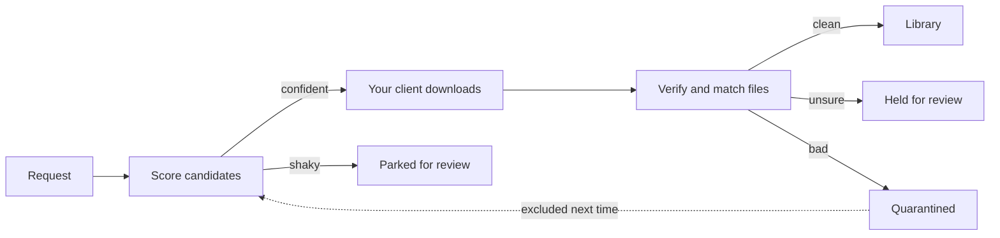

> [!WARNING]
> **This is an AI vibe-coded fork** of [DroppedNeedle](https://github.com/DroppedNeedle/DroppedNeedle). It was built with AI coding tools rather than written by hand, and it is not affiliated with or supported by the upstream project. Report problems with this fork here, not upstream. Every change is in the [commit history](https://github.com/cookie-monster1649/DroppedNeedle/commits/nuc/v3.0.0-beta.4/).

## About this fork

This fork is based on upstream `v3` and lives on the branch `nuc/v3.0.0-beta.4`. It's built as the image `ghcr.io/cookie-monster1649/droppedneedle:nuc-v3.0.0-beta.4` and runs on a single home-server deployment. Its main aim: music MusicBrainz doesn't know (Deezer and Spotify releases) should be handled as well as music it does.

### What it changes

**Deezer metadata and other sources**
- **Deezer as a metadata source (stage a):** Deezer albums and artists get permanent stand-in IDs prefixed `d0ab1e00-50c3-8…`, recorded in a `source_identities` table. Their pages are served from Deezer data, and a single guard keeps these IDs away from MusicBrainz, Cover Art Archive, ListenBrainz, Last.fm and AudioDB.
- **Deezer tags:** files from Deezer albums get `DEEZER_ALBUMID`, `DEEZER_TRACKID` and `DEEZER_ARTISTID` tags.
- **Switching to MusicBrainz:** an album moves to MusicBrainz automatically once MusicBrainz has a confident match.
- **Deezer album pages:** these show the full tracklist, with missing tracks in line, just like a MusicBrainz album.
- **Writing names to files:** accepting a Deezer match writes its titles and artists into the files.
- **Matched, not local-only:** albums with an accepted Deezer match count as matched rather than local-only.

**Check albums, matching and editions**
- **Best guess:** albums MusicBrainz lacks get Deezer suggestions, and strong guesses from any catalogue appear under Best guess.
- **New tabs:** an Artists tab lists artists MusicBrainz lacks, and a Duplicates tab lists albums held twice.
- **Closest candidate:** an album with no good match shows its nearest candidate, so you can use that.
- **Default edition:** requests default to the edition with the track count most editions share, not a bonus edition.
- **Matching by hand:** a hand match keeps the edition that was requested. Partial albums match by exact name or ISRC.
- **Fewer albums stuck in To Decide:** when the same tracks arrive more than once, only the best copy of each is kept. Weak held albums then re-match by themselves.
- **Merging:** "Merge albums" folds copies of a release together, keeping the best file of each song. Same-folder albums merge by themselves.

**Spotify and playlists**
- **Spotify metadata:** songs import with Spotify's title, artist, album, ISRC and link, even when MusicBrainz doesn't know them.
- **Syncing:** imported playlists can follow Spotify, and new songs added there are requested automatically.
- **Import screen:** a loading state while the tracklist is fetched, then accurate per-track statuses.
- **Linking to your library:** playlist entries link to the library's copy by ID, by request, or by name. Name-linking ignores apostrophe style (’ vs ').
- **Removed songs:** a song removed from a playlist is remembered for that file only. It isn't fetched again, but can be requested anew.
- **Per-row status:** each row shows in library, missing, fetching, waiting for a decision or failed, with its own request button.

**Requests and downloads**
- **Requests by name:** you can request a track by name, with no MusicBrainz ID. A download that agrees with the request imports by itself.
- **Already in the library:** a request for a song the library already holds is marked done, not searched. Held imports never file a second copy of a song.
- **Track numbers:** song requests carry a track and disc number (from Spotify or Deezer), used when a file has none.
- **Deezer album requests:** "Request album?" on a Deezer album asks for every missing track.
- **Plugin sources:** YouTube and SoundCloud plugin searches get the album and the track length. Length is checked against Deezer, and a hold with no release doesn't blocklist the source.
- **Usenet:** a finished job is found even when the mount points at a category folder.
- **Downloads page:** a found copy can be used as the other edition it holds. Several Soulseek searches run at once. A 30-second sample button sits on downloads and held files.

**Artists**
- **Linking to MusicBrainz:** an artist with no MusicBrainz ID is linked through its Deezer artist's MusicBrainz URL relation.
- **Shared IDs:** if another artist already holds that MusicBrainz ID, a merge is suggested in the Artists tab.

**Other**
- **Login:** `OIDC_NEW_USER_ROLE` sets the role for new SSO accounts.
- **Player:** a track that ends unheard is reloaded transcoded. A playlist row's play button starts the queue at that row.

### Keeping upstream merges easy
- Changed upstream code is marked with `Fork:` comments, kept small, and placed at hook points.
- New behaviour lives in additive tables (fork extension migrations) and isolated modules, for example the source layer.
- Stand-in IDs reuse the existing MusicBrainz ID columns, so upstream's routes, caches and plans work unchanged.
- To merge upstream:
  1. `git fetch upstream && git merge upstream/v3`
  2. Resolve the `Fork:` hunks.
  3. Run the Rust and frontend suites. Source gates (`tests/server/source_gates.rs`) list fork spawn sites.

### Build and deploy
- **Normal path:** pushing the branch runs CI, and the `nuc-image` workflow publishes the image. The deployment then runs `docker compose pull && docker compose up -d`.
- **Fallback when GitHub Actions is unavailable** (for example, budget-blocked):
  1. Run the test suites locally.
  2. `docker build` the image on the host under the same tag, keeping a rollback tag of the previous image.
  3. Run `up -d` without pulling.
  4. Prune the build cache.
- **Before any deploy:** back up `library.db`, and `metadata-cache.db` when sources change, and restart only when no import is running.

### Known gaps
- **The metadata-source roadmap is incomplete:**
  - b: downloads and landing against a source release, giving a one-download Deezer album request;
  - c: Deezer artist pages, bios and covers;
  - d: matching and editions;
  - e: Spotify as a source.

  Until stage b, a Deezer album request is one search per song.
- **CI Audit and Licenses fail:** this is the bundled-SQLite advisory in `libsqlite3-sys`, which upstream also has.

The fork's plan and notes are in [docs/fork/PLAN.md](docs/fork/PLAN.md).

<div align="center">


**Request music. Own everything.**

DroppedNeedle is a self-hosted music request and discovery app for you and the people you share a server with. Search MusicBrainz, request an album or a single track, and it fetches it through your own slskd or SABnzbd, checks every file and files it in your library. Then play it in the browser, or in Symfonium, Finamp, Feishin and other Subsonic or Jellyfin apps.

One container. No Lidarr.

[](LICENSE)
[](https://github.com/DroppedNeedle/DroppedNeedle)
[](https://hub.docker.com/r/droppedneedle/droppedneedle)
[](https://discord.gg/B5suDg7gu2)
[](docs/README.md)

[Docs](docs/README.md) | [Website](https://www.droppedneedle.com/) | [Discord](https://discord.gg/B5suDg7gu2) | [Issues](https://github.com/DroppedNeedle/DroppedNeedle/issues) | [Sponsor](https://github.com/sponsors/HabiRabbu)

</div>

---


<details>
<summary>More screenshots</summary>


</details>

> [!NOTE]
> DroppedNeedle only drives a download client you run yourself. It never joins a P2P network, ships no indexers and hosts no audio. What you fetch, and what your client shares, is your call and your responsibility.

## What it does

- **Requests** for whole albums or single tracks from the MusicBrainz catalog, with an approval queue for the User role.
- **Downloads** through your slskd, your SABnzbd with Newznab indexers or Prowlarr, or a plugin. It scores the candidates, verifies every file and holds what it isn't sure of.
- **Wanted and upgrades**: failed and partial requests are searched again until a verified copy shows up, and a better copy replaces a worse one.
- **Your library**, scanned and identified against MusicBrainz and AcoustID without renaming or retagging anything. Browse, search, rate and play it.
- **Library Management**, off until you turn it on: Picard-style tags, artwork and file naming behind a preview, with undo.
- **Drop imports** for music you bought elsewhere: drag in a zip or loose files.
- **Discovery**: trending, charts, genres, recommendations from ListenBrainz or Last.fm, a discover queue, a weekly mix, new releases from artists you follow, and gig alerts for your cities.
- **A web player** with a queue, a 10-band EQ, lyrics and live now-playing.
- **Playlists** mixing your library, Jellyfin, Navidrome, Plex, YouTube and Spotify imports.
- **Plugins** for more download sources, scrobble targets and purchase links.

Every feature, one line each: [docs/features.md](docs/features.md).

How a request moves:



The engine searches your client, ranks candidates, and accepts a confident match by itself. Close calls wait for review instead of guessing.

## Quick start

You need Docker, a music library, and a download client. The example below uses slskd; [SABnzbd](https://sabnzbd.org/) with Newznab indexers or Prowlarr works too. DroppedNeedle runs neither for you: see [Download clients](docs/download-clients.md).

**1. Save this compose file.** Images are on [Docker Hub](https://hub.docker.com/r/droppedneedle/droppedneedle) as `droppedneedle/droppedneedle`.

```yaml
services:
  droppedneedle:
    image: droppedneedle/droppedneedle:latest
    container_name: droppedneedle
    environment:
      - PUID=1000            # run `id` on your host to find your user/group ID
      - PGID=1000
      - UMASK=027            # secure default; 002 for trusted group-writable media
      - PORT=8688
      - TZ=Etc/UTC           # e.g. Europe/London, America/New_York
      - SLSKD_DOWNLOADS_PATH=/data/slskd/complete
    ports:
      - "8688:8688"
    volumes:
      - ./config:/app/config
      - ./cache:/app/cache
      - ./plugins:/app/plugins  # omit and installed plugins vanish on recreate
      - ./imports:/app/imports  # uploads waiting for a match; omit and they vanish on recreate
      # One shared parent mount keeps the library and completed downloads on one
      # boundary so imports move fast. Do not nest extra binds under /data.
      - /path/to/media:/data:rw
    restart: unless-stopped
```

The full annotated compose, with an optional slskd sidecar, is [docker-compose.example.yml](docker-compose.example.yml). Every environment variable is in [Configuration](docs/configuration.md).

**2. Start it.**

```bash
docker compose up -d
```

Then open [http://localhost:8688](http://localhost:8688).

**3. First run.**

1. Create the first admin account. This happens once.
2. Add your library path under Settings > Library, using the in-container path (e.g. `/data/music`).
3. Add your download client under Settings > Download Client, then Test and Save.
4. Press Scan for changes on Settings > Library. The scan reads and identifies files without renaming or retagging anything.
5. Search the catalog, open an album, and Request it. Watch it land live on the Downloads page.

Bringing in a collection you want filed and tagged? See [Bringing in an existing library](docs/downloads.md#bringing-in-an-existing-library).

To update, run `docker compose pull` and `docker compose up -d`. DroppedNeedle backs up its database before a new version changes it: see [Backups and restore](docs/backups-and-restore.md).

## Coming from v2

Stop v2, switch the image to a v3 tag (such as `:v3.0.0`, or `:latest` once v3 is released) and start it. It serves an upgrade page that checks first, upgrades your data in place and keeps your v2 files so you can go back.
Callback addresses for single sign-on, Spotify playlist import and MusicBrainz contributions change, and v2 plugins need porting.
Follow [Upgrading from v2](docs/upgrading-from-v2.md), and read [What changed in v3](docs/v3-changes.md) first.

## Works with your apps

- **Music apps.** DroppedNeedle answers the OpenSubsonic and Jellyfin APIs, so Subsonic apps (Symfonium, Feishin, Arpeggi) and Jellyfin apps (Finamp, Jellify, Manet) can play your library. [Connect your music app](docs/connect-your-app.md) says what to enter.
- **Media servers.** It plays from Jellyfin, Navidrome, Plex or local files, and reports plays back to your own account there.
- **Scrobbling.** ListenBrainz and Last.fm, per user.
- **Sign-in.** Single sign-on through any OpenID Connect provider, and sign-in with Plex or Jellyfin: see [Accounts and sign-in](docs/accounts-and-sign-in.md).

## Docs

- [Configuration](docs/configuration.md): environment variables, folders, permissions, where each setting lives, updating.
- [Download clients](docs/download-clients.md): slskd, SABnzbd and drop imports.
- [Accounts and sign-in](docs/accounts-and-sign-in.md): roles, single sign-on, Plex and Jellyfin sign-in, recovery.
- [Connect your music app](docs/connect-your-app.md): Subsonic and Jellyfin apps.
- [Your library](docs/library.md) and [Library Management](docs/library-management.md).
- [Requests and downloads](docs/downloads.md) and [Discovery](docs/discovery.md).
- [Reverse proxy and security](docs/reverse-proxy-and-security.md) and [Backups and restore](docs/backups-and-restore.md).
- [Troubleshooting](docs/troubleshooting.md).
- [Plugins](PLUGINS.md) and [Writing a plugin](docs/writing-a-plugin.md).

The full list is in [docs/README.md](docs/README.md).

## Contributing

Bug reports and feature requests go to [Issues](https://github.com/DroppedNeedle/DroppedNeedle/issues), code to pull requests. Dev setup, tests and style rules are in [CONTRIBUTING.md](CONTRIBUTING.md). AI-assisted contributions are welcome: see [Using AI](CONTRIBUTING.md#using-ai).

## Support and license

Chat: [Discord](https://discord.gg/B5suDg7gu2). Bugs and ideas: [GitHub Issues](https://github.com/DroppedNeedle/DroppedNeedle/issues).

<div align="center">

[](https://ko-fi.com/M4M41URGJO)
[](https://github.com/sponsors/HabiRabbu)

If DroppedNeedle earns its keep, fuel it. Monthly or one-off, both welcome.

</div>

DroppedNeedle is [AGPL-3.0](LICENSE). Copyright (c) 2025 DroppedNeedle and contributors. For commercial licensing, write to contact@droppedneedle.com.

The Docker image bundles [FFmpeg](https://ffmpeg.org) under the LGPL, built with libmp3lame and libopus, to transcode FLAC, MP3, Ogg Vorbis, Opus, AAC, ALAC and WAV. Its license files, configure line and source are in `/usr/share/doc/ffmpeg/` inside the image, and libmp3lame's Debian source is in `/usr/share/doc/ffmpeg/lame/`.

The licenses of the Rust crates and web UI packages DroppedNeedle is built from are in `/usr/share/doc/droppedneedle/` inside the image (`NOTICES-server.txt` and `NOTICES-web-ui.txt`), beside DroppedNeedle's own `LICENSE`.
